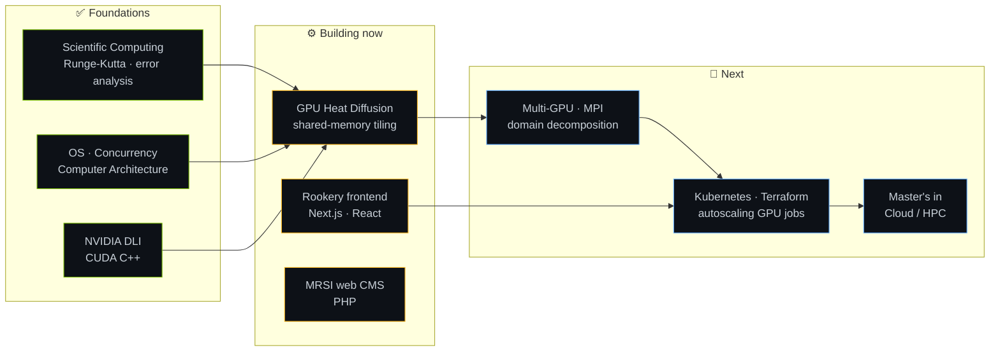

<!-- Header: a live 2D heat-equation simulation (assets/heat-banner.svg) -->

  

  

  
  
  
  

<!-- Terminal card styled like nvidia-smi (assets/nvidia-smi.svg) -->

  

---

## `$ whoami`

I'm a **Computer Science (Honours, Co-op)** student at **McMaster University**, graduating **April 2027**. I'm also a **Research Software Engineer** for McMaster's Faculty of Science. I like software that is **fast, correct, and actually used**, and I'm steering toward **cloud and high-performance computing**: GPUs, parallel systems, and the infrastructure that runs them at scale.

- ⚡ **GPU computing:** NVIDIA DLI certified in *Accelerated Computing with Modern CUDA C++*; now writing my own CUDA solvers
- 🔬 **Research software:** I build tools that turn hours of manual lab work into a single click
- 🏗️ **Systems foundation:** Operating Systems, Concurrent Systems, Computer Architecture, Networks & Security, Scientific Computing
- 🎯 **Next:** a master's in cloud/HPC, then multi-GPU, distributed, and cloud-native compute

---

## 🛰️ Path to Cloud HPC

---

## 🔥 Currently Building

<table>
<tr>
<td width="50%" valign="top">

### 🌡️ GPU Heat Diffusion Simulator
`CUDA C++` · `in progress`

A 2D heat-equation solver written as CUDA kernels with **shared-memory tiling** and benchmarked against a CPU baseline for speedup and memory bandwidth. *The banner at the top of this page runs the same equation.*

**Roadmap:** multi-GPU with MPI → containerized, autoscaling GPU jobs on Kubernetes

</td>
<td width="50%" valign="top">

### ♟️ Rookery: Chess Variant Engine
`Next.js` · `React` · `TypeScript` · `capstone`

A team capstone: a platform for **creating, sharing, and playing chess variants**, with a no-code variant editor, a shared TypeScript rules engine, and real-time multiplayer.

**My role:** building the frontend UI and integrating it with the rules engine and backend services.

</td>
</tr>
<tr>
<td width="50%" valign="top">

### 🧪 MRSI Data Normalization Tool
`Python` · `PyQt6` · `openpyxl`

A desktop app that **automates processing and standardization of raw mass-spectrometer data** for McMaster's MRSI research group. It replaces manual data entry, eliminates transcription errors, and saves **several hours per dataset**. Unit-tested on edge cases and shaped by direct lab feedback.

</td>
<td width="50%" valign="top">

### 🌐 mrsi.mcmaster.ca
`PHP` · `custom CMS`

A modern rebuild of the research group's website, plus a **built-in editor** (a custom, lightweight WordPress-style CMS) that lets staff change text, images, page sections, and the site chatbot without touching code.

</td>
</tr>
</table>

---

## 🚀 Featured Projects

  
  
  
  

| Project | What it does | Highlights |
| :-- | :-- | :-- |
| 🏭 **Steel Defect Classifier** | CNN that classifies manufacturing defects on metal surfaces | PyTorch · 51.5M params · **91.67%** accuracy · PyQt6 GUI |
| 🌀 **Double Pendulum Simulation** | Chaotic-motion simulator with real-time visualization | C++ · Runge-Kutta · step-size convergence · **15%** less numerical error |
| 💸 **EasyBudget AI** | Shared household budgeting app on the App Store | Flutter · OCR/NLP receipt scanner |

---

## 🧰 Tech Stack

<b>Languages</b>  
  

<b>HPC & GPU</b>  
  
  
  

<b>AI, Data & Frameworks</b>  
  

<b>Cloud, DevOps & Data</b>  
  

<b>Learning next</b>  
  
  &nbsp;
  
  

---

## 📈 Activity

  

  
  

  

---

  <code>__global__ void build(Idea* ideas) { ship(ideas[threadIdx.x]); }</code> 
  Banner: a real FTCS solve of ∂u/∂t = α∇²u, rendered as an animated SVG · always open to talk about GPUs, cloud, and research software

